<p align="center">
  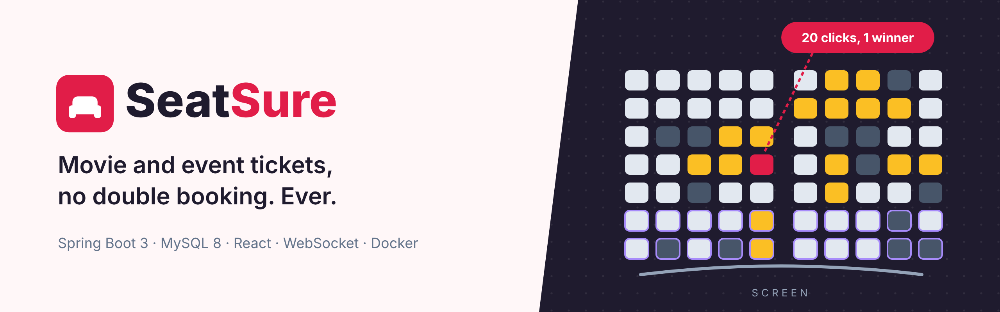
</p>

<p align="center">
  <a href="https://github.com/username1puni/seatsure/actions/workflows/ci.yml"></a>
  
  
  
  
  
  <a href="LICENSE"></a>
</p>

<p align="center">
  <b><a href="https://seatsure.sites.tab.bot/">Live demo</a></b> &middot;
  <a href="https://seatsure.sites.tab.bot/swagger-ui.html">API docs (Swagger)</a> &middot;
  <a href="#how-double-booking-is-prevented">How double booking is prevented</a>
</p>

# SeatSure

SeatSure is a movie and event ticket booking system, similar to what BookMyShow or PVR do. You pick a
city and a date, choose a show, select seats on a live seat map, pay, and get a ticket with a QR code.
Theatre owners (admins) set up theatres, screens, seat layouts, shows and prices, and see revenue on a
dashboard.

The interesting part is the backend. When a popular show opens, many people click the same seat at the
same moment. SeatSure guarantees that **exactly one of them gets it**: seats are held inside a MySQL
transaction with row locks, a unique key makes a second live booking of a seat impossible at the
database level, optimistic locking protects the background jobs, and a held seat is released
automatically if the user does not pay within 5 minutes. All of this is covered by integration tests
that run against a real MySQL server, including one where 20 threads try to book the same seat.

## Features

**For users**
- Sign up and log in (JWT). Browse movies and events by **city and date**, see show times per theatre
  with how full each show is.
- **Live seat map** with normal and premium rows. Seats being booked by someone else turn yellow and
  sold seats turn grey on everyone's screen within a second (STOMP over WebSocket).
- Seats are **held for 5 minutes** while you pay, with a countdown. Going back to change seats or a
  failed payment releases them right away.
- **Payment**: a built-in test payment gateway (mock, HMAC signed) works out of the box. A Razorpay
  test mode integration is included but needs your own test keys (see [Limitations](#limitations)).
- **Ticket with QR code**, downloadable as a PDF. The QR carries a signed token that the admin
  check-in screen verifies. Tickets are also emailed when SMTP is configured.
- **Booking history**, cancellation with a **refund preview** (100% up to 24 h before the show, 75% up
  to 2 h before, no cancellation after that).

**For admins**
- Add cities, theatres and screens with a **seat layout editor** (rows, seats per row, premium rows).
- Schedule shows (clash check on the same screen), set **normal / premium prices**, cancel a show
  (everyone gets refunded).
- **Dashboard**: total revenue, revenue for the last 7 days, most booked shows and movies, seats on
  hold right now.
- **Ticket check-in**: scan the QR with any scanner app, paste the text, and the ticket is verified
  and marked as used.

## Screenshots

| Home: movies and events in your city | Show times by theatre |
| --- | --- |
| 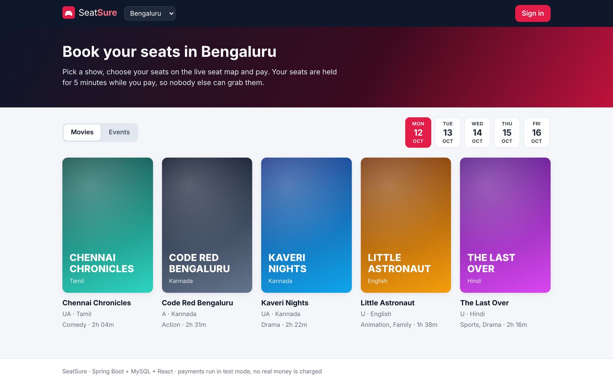 | 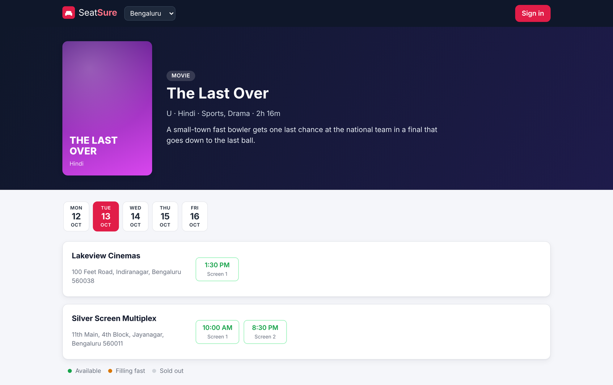 |

| Live seat map | Test payment |
| --- | --- |
| 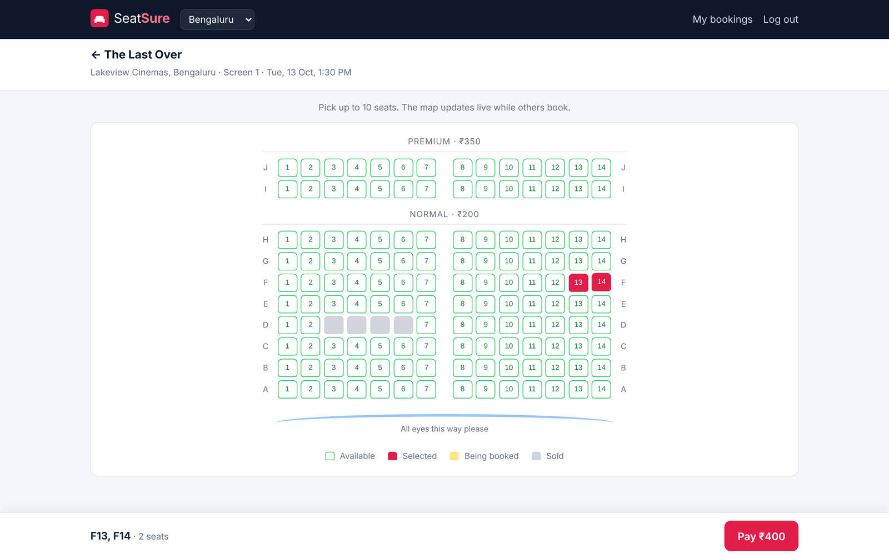 | 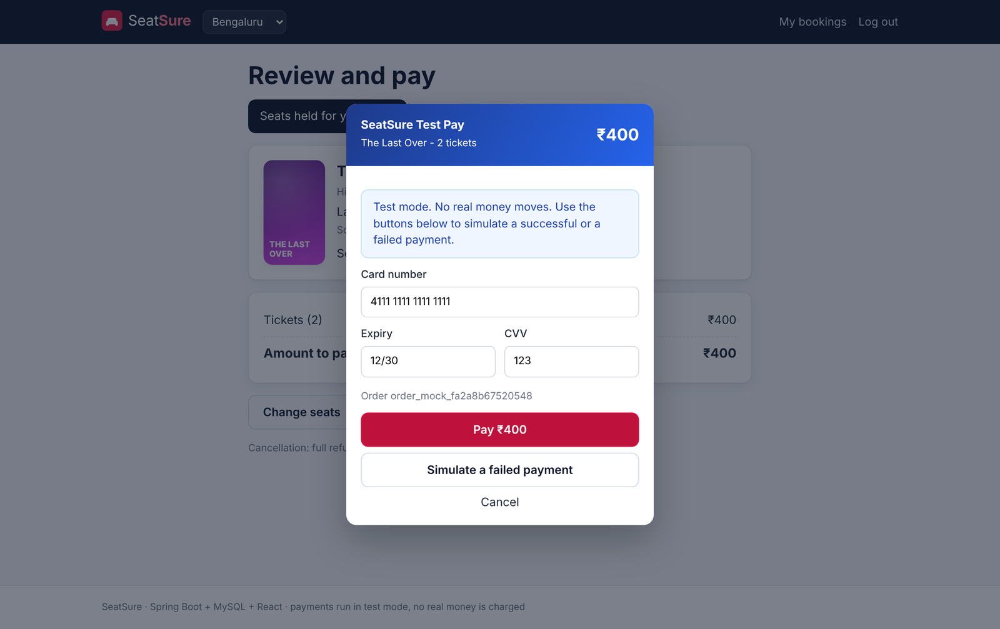 |

| Ticket with QR code | Admin dashboard |
| --- | --- |
| 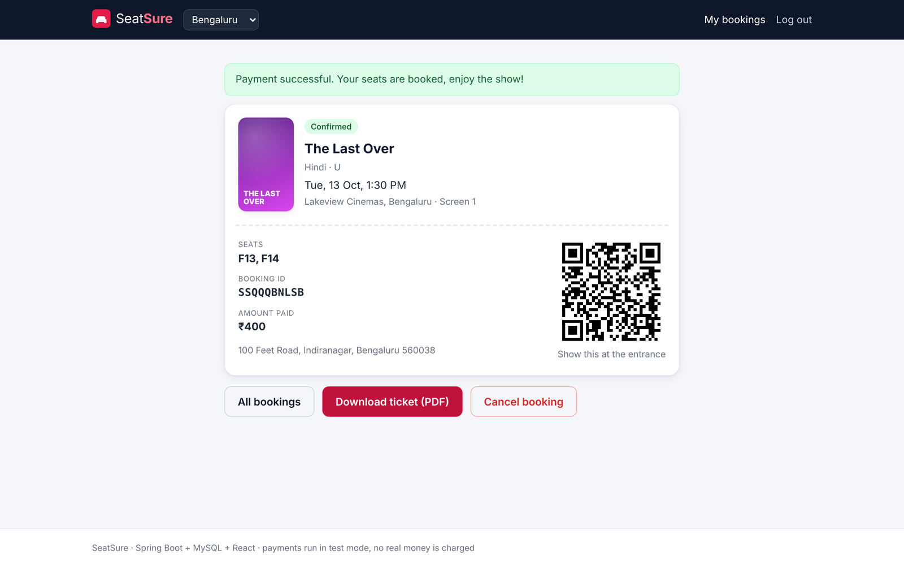 | 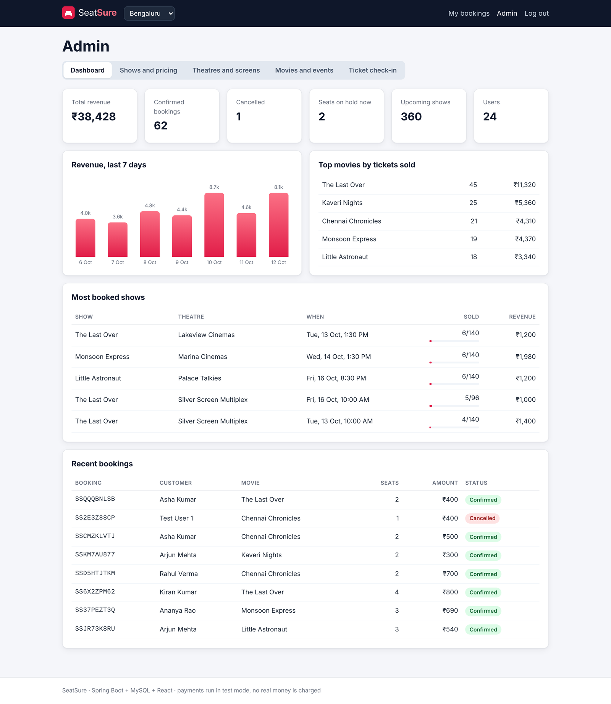 |

| Admin: theatres, screens and seat layouts | On a phone |
| --- | --- |
| 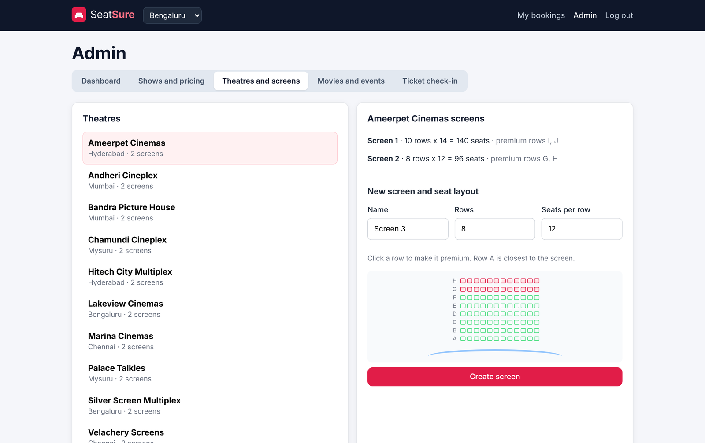 | 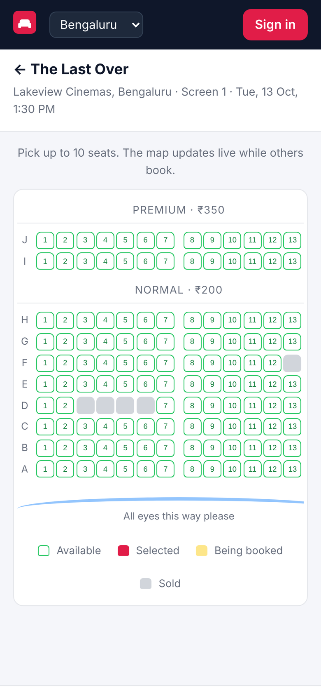 |

## How double booking is prevented

<p align="center">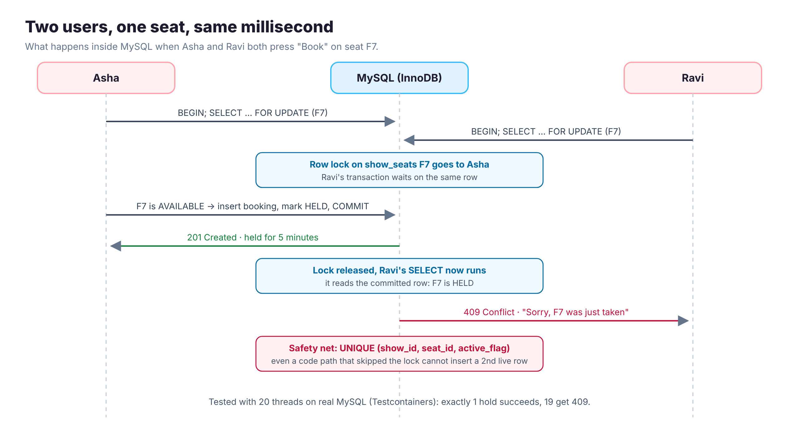</p>

A booking goes through three states: **hold** (seats reserved for 5 minutes), **pay**, **confirm**.
Every step that changes a seat runs inside one database transaction in `BookingService`.

1. **Pessimistic lock on the hold.** `show_seats` has one row per seat per show. When a user holds
   seats, the service runs `SELECT ... FOR UPDATE` on exactly those rows (Spring Data
   `@Lock(PESSIMISTIC_WRITE)`), always in id order. A second user asking for any of the same seats waits
   on the row lock, and when the first transaction commits it sees the seat as `HELD` and gets
   `409 Conflict`. Either all requested seats are held or none are.
2. **Unique key as a safety net.** `booking_seats` has a generated column `active_flag` that is `1`
   for `HELD` / `CONFIRMED` rows and `NULL` otherwise, with `UNIQUE (show_id, seat_id, active_flag)`.
   MySQL has no partial indexes, but `NULL`s never clash in a unique key, so a seat can have many old
   cancelled rows and only one live one. Even a future code path that forgot the lock could not sell a
   seat twice.
3. **Optimistic locking for the expiry job.** `HoldExpiryJob` runs every 10 seconds and releases holds
   older than 5 minutes. It does not take locks; `bookings` and `show_seats` have a `@Version` column, so
   if a payment confirmed the booking a moment earlier, the job's update fails with
   `ObjectOptimisticLockingFailureException` and the job just moves on.
4. **Payment confirm is all or nothing.** The payment row, the booking, the seats and the ticket token
   are written in one transaction. If anything fails in the middle, everything rolls back. A payment
   that arrives after the hold expired is refunded instead of confirmed.
5. **One lock order everywhere** (booking row first, then seat rows by id), so these transactions do
   not deadlock each other.

The tests in [`SeatBookingConcurrencyIT`](backend/src/test/java/com/seatsure/booking/SeatBookingConcurrencyIT.java)
and [`HoldExpiryAndPaymentIT`](backend/src/test/java/com/seatsure/booking/HoldExpiryAndPaymentIT.java)
prove each point against MySQL 8.4 in Docker:

| Test | Result |
| --- | --- |
| 20 threads hold the same seat at the same moment | exactly 1 succeeds, 19 get "seat taken" |
| 16 threads with overlapping multi-seat selections | no seat is ever in two bookings, each hold is all or nothing |
| Insert a second live `booking_seats` row directly | rejected by the unique key |
| Stale update of a `show_seats` row | rejected by `@Version` |
| Payment racing the expiry job (repeated 10 times) | always ends either confirmed or expired and refunded, never half done |
| Exception in the middle of confirming a payment | every write rolled back, seats back to held, user refunded |

## Architecture

<p align="center">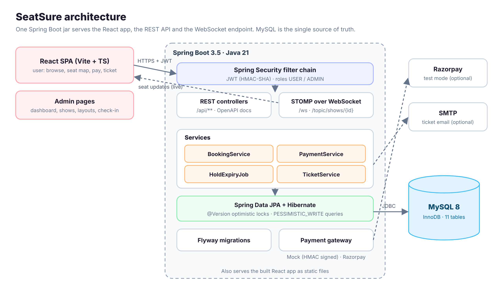</p>

- **Frontend**: React 19 + TypeScript + Vite single page app. In production it is built into the Spring
  Boot jar and served from the same origin, so there is one thing to deploy.
- **Backend**: Spring Boot 3.5 on Java 21, layered as controller -> service -> repository, with DTOs and
  Bean Validation on every request, a global exception handler that returns readable JSON errors, and
  OpenAPI docs.
- **Security**: Spring Security with stateless JWT (jjwt), BCrypt password hashes, `USER` and `ADMIN`
  roles. Users can only see and cancel their own bookings.
- **Realtime**: Spring's simple STOMP broker. Every seat change is published to `/topic/shows/{id}`
  after the transaction commits, so viewers never see a seat change that was rolled back.
- **Database**: MySQL 8.4 (InnoDB), schema managed by Flyway.
- **Payments**: a `PaymentGateway` interface with two implementations, `MockPaymentGateway` (default)
  and `RazorpayPaymentGateway`, picked with `PAYMENT_GATEWAY=mock|razorpay`.

### Database

<p align="center">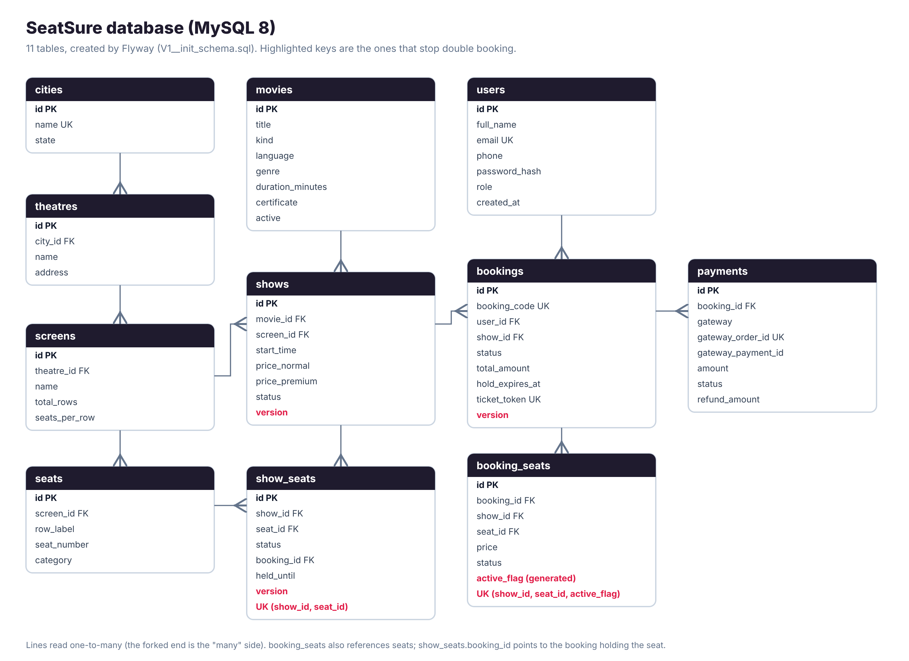</p>

`show_seats` is the live state of the seat map (`AVAILABLE`, `HELD`, `BOOKED`) and is what gets locked.
`booking_seats` is the history of which booking owned which seat at what price, and carries the unique
key that blocks double booking.

## Tech stack

| Area | Tools |
| --- | --- |
| Backend | Java 21, Spring Boot 3.5 (Web MVC, Data JPA, Security, Validation, WebSocket, Mail, Actuator), Lombok |
| Database | MySQL 8.4, Flyway |
| Auth | Spring Security, JWT (jjwt), BCrypt |
| Tickets | ZXing (QR codes), OpenPDF (PDF tickets) |
| API docs | springdoc-openapi (Swagger UI) |
| Frontend | React 19, TypeScript, Vite, React Router, STOMP.js, Vitest + Testing Library |
| DevOps | Docker (multi-stage), docker compose, GitHub Actions, Maven wrapper, JaCoCo |
| Testing | JUnit 5, AssertJ, Spring MockMvc, Testcontainers (MySQL) |

## Run it locally

### With Docker (easiest)

```bash
git clone https://github.com/username1puni/seatsure.git
cd seatsure
cp .env.example .env        # then set the passwords, JWT_SECRET and the admin login
docker compose up --build
```

Open http://localhost:8080 and log in with the `ADMIN_EMAIL` / `ADMIN_PASSWORD` you set. With
`SEED_DEMO_DATA=true` the database is filled with 5 cities, theatres, movies, events and 5 days of shows.
Swagger UI is at http://localhost:8080/swagger-ui.html.

### Without Docker

You need Java 21, Node 22 and MySQL 8.

```bash
# database
mysql -uroot -p -e "CREATE DATABASE seatsure; CREATE USER 'seatsure'@'localhost' IDENTIFIED BY 'seatsure'; GRANT ALL ON seatsure.* TO 'seatsure'@'localhost';"

# backend (http://localhost:8080)
cd backend
export DB_URL=jdbc:mysql://localhost:3306/seatsure DB_USERNAME=seatsure DB_PASSWORD=seatsure
export JWT_SECRET=$(openssl rand -base64 48) ADMIN_EMAIL=admin@example.com ADMIN_PASSWORD=change-me
./mvnw spring-boot:run

# frontend dev server (http://localhost:5173), in another terminal
cd frontend
npm install
npm run dev
```

## API

Interactive docs: [Swagger UI](https://seatsure.sites.tab.bot/swagger-ui.html) (OpenAPI JSON at `/v3/api-docs`).

| Method | Endpoint | Auth | What it does |
| --- | --- | --- | --- |
| POST | `/api/auth/register`, `/api/auth/login` | - | Create an account / log in, returns a JWT |
| GET | `/api/auth/me` | user | Current user |
| GET | `/api/cities` | - | Cities |
| GET | `/api/movies?cityId=&date=` | - | Movies and events playing in a city on a date |
| GET | `/api/movies/{id}`, `/api/movies/{id}/dates`, `/api/movies/{id}/shows` | - | Details, dates with shows, shows grouped by theatre |
| GET | `/api/shows/{id}`, `/api/shows/{id}/seats` | - | Show details and the seat map |
| POST | `/api/bookings/hold` | user | Hold seats for 5 minutes (`409` if any seat is taken) |
| DELETE | `/api/bookings/{id}/hold` | user | Release a hold |
| GET | `/api/bookings`, `/api/bookings/{id}` | user | My bookings |
| GET | `/api/bookings/{id}/refund-preview` | user | How much a cancellation would refund |
| POST | `/api/bookings/{id}/cancel` | user | Cancel and refund |
| GET | `/api/bookings/{id}/ticket.pdf`, `/api/bookings/{id}/qr.png` | user | Ticket PDF and QR code |
| GET | `/api/payments/config` | - | Which gateway is active |
| POST | `/api/payments/order`, `/api/payments/verify`, `/api/payments/failure` | user | Create an order, verify the signed payment, report a failure |
| POST | `/api/payments/mock/checkout` | user | Test gateway: simulate a successful or failed payment |
| GET | `/api/admin/dashboard` | admin | Revenue and booking stats |
| GET, POST, PUT | `/api/admin/theatres`, `/api/admin/screens`, `/api/admin/movies`, `/api/admin/cities` | admin | Manage theatres, screens (seat layouts), movies, cities |
| GET, POST | `/api/admin/shows` | admin | List and schedule shows |
| PUT | `/api/admin/shows/{id}/pricing` | admin | Change normal / premium prices |
| POST | `/api/admin/shows/{id}/cancel` | admin | Cancel a show and refund everyone |
| POST | `/api/admin/tickets/verify` | admin | Check in a ticket from its QR token |

Live seat updates: STOMP endpoint `/ws`, topic `/topic/shows/{showId}`.

## Project structure

```
seatsure/
├── backend/                     Spring Boot API
│   └── src/main/java/com/seatsure/
│       ├── controller/          REST endpoints
│       ├── service/             booking (hold / confirm / cancel), payments, tickets, expiry job
│       │   ├── payment/         PaymentGateway, mock and Razorpay implementations
│       │   └── admin/           theatres, screens, shows, dashboard
│       ├── security/            JWT filter and service
│       ├── entity/ repository/ dto/ config/ exception/
│   └── src/main/resources/db/migration/   Flyway SQL
├── frontend/                    React + TypeScript (Vite)
├── docs/images/                 diagrams and screenshots
├── Dockerfile, docker-compose.yml
└── .github/workflows/ci.yml
```

## Testing

```bash
cd backend && ./mvnw verify     # unit + integration tests (needs Docker for Testcontainers), JaCoCo report
cd frontend && npm test         # Vitest
```

| Suite | Tests | What is covered |
| --- | --- | --- |
| Backend unit tests | 15 | JWT, refund policy, booking codes, seat layout rules, payment signatures |
| Backend integration tests (MySQL in Docker) | 22 | concurrency, hold expiry, payment races and rollback, full booking API, admin API, security rules |
| Frontend tests | 11 | seat selection, seat map rendering, live updates applied to the map |

GitHub Actions runs all of it, plus the frontend lint and a Docker build, on every push.

## Limitations

- **Payments are a mock gateway in the live demo.** It behaves like a real one (orders, HMAC signed
  payment confirmation, simulated failures, refunds), but no money moves. The Razorpay test mode
  class is written against Razorpay's documented API but has **not been tested**, because I do not
  have Razorpay test keys yet.
- **Tickets are not emailed in the live demo.** Email works only when SMTP settings are given; the
  ticket is always available as a QR code and PDF on the bookings page.
- The STOMP broker is Spring's in-memory one, so live seat updates work for a single server instance.
  Running several instances would need an external broker (RabbitMQ / Redis).
- Holds are stored in MySQL and cleaned up by a scheduled job every 10 seconds, so a released seat can
  show as held for a few seconds after the 5 minutes are up.
- The live demo runs on a small server with demo data that resets when the server is replaced.

## License

[MIT](LICENSE) &copy; 2026 S Manohara
